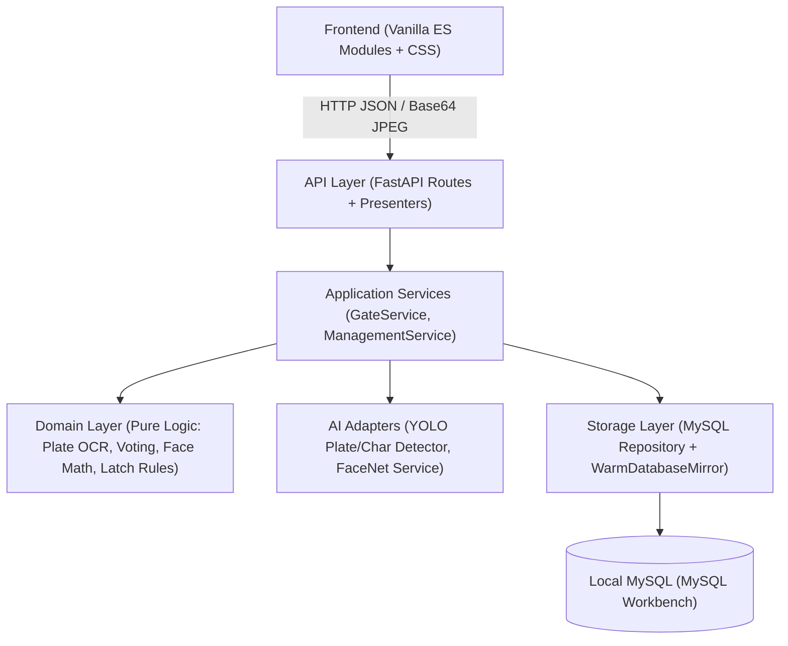

# architecture.md — Kiến trúc Hệ thống & Quyết định Kỹ thuật (DATN2)

---

## 1. Đánh giá các vấn đề tồn đọng ở phiên bản gốc (`C:\Study\DATN`)

Qua rà soát toàn bộ mã nguồn gốc:
1. **God Files quá lớn & chồng chéo trách nhiệm**:
   - `main.py` (`2.032` dòng / `80 KB`): gộp chung FastAPI routes, Pydantic models, OCR biển số, voting, xử lý ảnh, trạng thái 2 camera, máy trạng thái Two-Phase Latch, cảnh báo an ninh, cache overview, DB commit executor và vòng lặp reconnect.
   - `database.py` (`1.555` dòng / `60 KB`): gộp chung kết nối MySQL, DDL migration, seed demo, định dạng nhãn tiếng Việt cho UI, câu lệnh SQL đọc/ghi và lớp `WarmDatabaseMirror` (500 dòng).
   - `frontend/app.js` (`3.383` dòng / `122 KB`): 1 IIFE khổng lồ với >70 biến trạng thái và >55 hàm gộp WebRTC, vẽ Canvas, polling, bảng lịch sử, cache/prefetch, doanh thu, modal mất xe và xuất HTML-to-PDF.
2. **Trùng lặp logic nghiệp vụ**:
   - Hàm chuẩn hóa khóa biển số bị viết 2 nơi (`_clean_plate_key` trong `main.py` và `_normalize_search` trong `database.py`).
   - Logic lọc, sắp xếp, tính thống kê, doanh thu và ghép cặp phiên mất xe bị viết song song ở cả SQL và `WarmDatabaseMirror`.
   - Định dạng hiển thị tiếng Việt (`"Biển số"`, `"Luồng"`, `"Trạng thái bãi"`) bị trộn vào tầng database (`database.py`) thay vì tầng presenter/API.
3. **Khó kiểm thử cô lập**:
   - `SystemState` tạo cứng mọi dependency và khóa nội bộ, khiến unit test phải `mock.patch` trực tiếp vào biến toàn cục của module `main` và `database`.

---

## 2. Kiến trúc tổng thể `DATN2` (Clean Layered Architecture)

Hệ thống được phân tách thành **4 tầng rõ ràng** (chiều phụ thuộc chỉ đi từ ngoài vào trong):



---

## 3. Cấu trúc thư mục chi tiết trong `src/` và `tests/`

```text
C:\Study\DATN2\
├── AGENTS.md
├── spec.md
├── architecture.md
├── plan.md
├── tasks.md
├── progress.md
├── README.md
├── .env.example
├── .gitignore
├── pyproject.toml                   # Cấu hình pytest & pythonpath
├── requirements.txt
├── scripts/
│   ├── verify.ps1                   # Harness 1 lệnh: compileall + guardrails + JS check + pytest
│   └── check_guardrails.py          # Kiểm tra domain purity & giới hạn <= 400 dòng/file
├── weights/                         # Copy từ C:\Study\DATN\weights\ (read-only assets)
│   ├── plate_best.pt
│   └── chars_best.pt
├── datasets/                        # Copy data.yaml từ C:\Study\DATN\datasets\
│   ├── plates/data.yaml
│   └── chars/data.yaml
├── src/
│   ├── backend/
│   │   ├── __init__.py
│   │   ├── config.py                # Settings tập trung (env, ngưỡng AI, Latch, Cooldown, Fee, Cache)
│   │   ├── main.py                  # Entrypoint FastAPI (DI container, lifespan, uvicorn runner)
│   │   ├── domain/                  # Pure Python — KHÔNG phụ thuộc FastAPI/MySQL/YOLO
│   │   │   ├── __init__.py
│   │   │   ├── models.py            # Dataclasses: FaceDetection, PlateBox, VoteResult, LatchState, SecurityAlert, RecordData
│   │   │   ├── plate_normalizer.py  # Chuẩn hóa biển số VN, sửa lỗi OCR, clean_plate_key (1 nguồn duy nhất)
│   │   │   ├── plate_assembly.py    # IoU deduplication & gom dòng 1-line / 2-line
│   │   │   ├── voting.py            # Majority Voting & Fast-Confirm
│   │   │   ├── face_math.py         # Cosine similarity, serialization 512-D float32, xếp hạng độ nét mặt
│   │   │   └── image_utils.py       # Laplacian sharpness (vùng lõi 70%), crop JPEG Data URL, decode base64, disk snapshot
│   │   ├── ai/                      # Adapter cho mô hình AI
│   │   │   ├── __init__.py
│   │   │   ├── plate_detector.py    # Wrapper YOLOv8 (plate_best + chars_best), hỗ trợ batch 2 ảnh
│   │   │   └── face_service.py      # Wrapper MTCNN + InceptionResnetV1 (vggface2)
│   │   ├── storage/                 # Tầng dữ liệu MySQL & RAM Mirror
│   │   │   ├── __init__.py
│   │   │   ├── exceptions.py        # DatabaseConfigurationError, DatabaseOperationError
│   │   │   ├── mysql_client.py      # Kết nối trực tiếp MySQL kèm timeout & múi giờ UTC+7 (now_vn)
│   │   │   ├── migrations.py        # CREATE TABLE, ALTER TABLE cột/index tự động
│   │   │   ├── repository.py        # Truy vấn SQL thuần (insert, find_active_session, overview, revenue, session_case)
│   │   │   ├── warm_mirror.py       # WarmDatabaseMirror trên RAM đồng bộ 1-1 với MySQL
│   │   │   └── demo_seeder.py       # Nạp 38 bản ghi demo khi SEED_DEMO_DATA=1
│   │   ├── services/                # Nghiệp vụ điều phối (Use-cases)
│   │   │   ├── __init__.py
│   │   │   ├── camera_session.py    # CameraUnitState + vòng đời bật/tắt 2 camera
│   │   │   ├── latch_coordinator.py # Máy trạng thái Two-Phase Latch (4s) & phối hợp 2 cam
│   │   │   ├── gate_service.py      # Điều phối ingest frame, đối chiếu mặt, Security Alert, async DB commit
│   │   │   └── management_service.py# Overview cache, session-case cache, DB reconnect loop
│   │   └── api/                     # Tầng HTTP FastAPI & Presentation
│   │       ├── __init__.py
│   │       ├── schemas.py           # Pydantic request/response models
│   │       ├── presenters.py        # Định dạng nhãn tiếng Việt (format_record_row, format_vnd, ...)
│   │       ├── camera_routes.py     # /api/camera/*
│   │       ├── management_routes.py # /api/management/*
│   │       └── static_routes.py     # /, /ui và static assets frontend
│   ├── frontend/
│   │   ├── index.html               # Giao diện 3 màn hình + Modal mất xe (tải ES Module /js/main.js)
│   │   ├── css/
│   │   │   ├── tokens.css           # Biến màu Dark Mode, typography, spacing
│   │   │   ├── layout.css           # Topbar, workspace, panel, responsive grid
│   │   │   ├── components.css       # Buttons, pills, tables, pagination, banners, modal
│   │   │   └── camera.css           # Dual camera stage, HUD corners, overlay canvas
│   │   └── js/
│   │       ├── main.js              # Bootstrap, gắn sự kiện điều hướng & khởi chạy
│   │       ├── api.js               # Wrapper fetch() tập trung cho mọi REST endpoint
│   │       ├── state.js             # Store trạng thái frontend có cấu trúc
│   │       ├── utils.js             # escapeHtml, formatVnd, formatTimestamp, showBanner, fallback SVG
│   │       ├── camera.js            # WebRTC enumerateDevices, exact deviceId, lock trùng, frame loop 140ms
│   │       ├── overlay.js           # Vẽ Bounding Box biển số & khuôn mặt lên Canvas
│   │       ├── gate_ui.js           # Sync trạng thái 2 cam, Latch banner, Top-up feedback, Security Alert
│   │       ├── history.js           # Bảng lịch sử, lọc tab, search debounce, sort, phân trang, client cache/prefetch
│   │       ├── revenue.js           # KPI doanh thu & bảng chi tiết Ngày/Tháng/Năm có phân trang
│   │       ├── lost_case_modal.js   # Modal 3 khối (Check-in / Check-out / Người lấy xe) & xem ảnh đơn
│   │       └── pdf_export.js        # Tạo tài liệu in chuẩn A4 cho Lịch sử, Doanh thu và Biên bản mất xe
│   └── training/
│       ├── train_plates.py
│       └── train_chars.py
└── tests/
    ├── conftest.py                  # Fixtures chung (fake AI models, fake repository, TestClient)
    ├── unit/
    │   ├── test_plate_normalizer.py
    │   ├── test_plate_assembly.py
    │   ├── test_voting.py
    │   ├── test_face_math.py
    │   ├── test_image_utils.py
    │   └── test_presenters.py
    ├── integration/
    │   ├── test_mysql_repository.py
    │   ├── test_warm_mirror.py
    │   ├── test_gate_service.py
    │   ├── test_management_service.py
    │   └── test_api_routes.py
    └── e2e/
        └── test_full_parking_flow.py
```

---

## 4. Các quyết định kỹ thuật quan trọng (ADRs)

### ADR-01: Kết nối MySQL trực tiếp kèm Timeout tường minh (Không dùng Connection Pool)
- **Bối cảnh**: MySQL server (kể cả Local MySQL khi chạy lâu qua đêm) tự ngắt kết nối nhàn rỗi theo `wait_timeout`; `MySQLConnectionPool` dễ giữ socket chết gây treo hoặc lỗi `MySQL Connection not available`.
- **Quyết định**: Mở kết nối trực tiếp mỗi lần ghi/đọc với `connection_timeout=8`, `read_timeout=10`, `write_timeout=10`, `use_pure=True` và đóng ngay trong `finally`. Nhờ có `WarmDatabaseMirror`, phần lớn thao tác đọc không cần mở kết nối MySQL.

### ADR-02: Giữ `WarmDatabaseMirror` và tách Presenter khỏi Storage
- **Quyết định**:
  - `storage/repository.py` và `storage/warm_mirror.py` chỉ trả về **raw domain dicts** (không chứa nhãn tiếng Việt).
  - `api/presenters.py` là nơi duy nhất định dạng `format_record_row()` trả về JSON khớp 100% hợp đồng API cho frontend.
  - Giảm đáng kể trùng lặp và đảm bảo dữ liệu đọc từ MySQL hay từ RAM Mirror có cấu trúc đồng nhất.

### ADR-03: Tách `SystemState` thành `GateService` + `ManagementService` + `LatchCoordinator`
- **Quyết định**:
  - `CameraSessionManager`: chỉ quản lý trạng thái bật/tắt 2 camera và tracking per-cam.
  - `LatchCoordinator`: chỉ xử lý máy trạng thái Two-Phase Latch (`4.0s`) và chọn khuôn mặt sắc nét nhất.
  - `GateService`: điều phối AI inference, đối chiếu FaceNet, Security Alert và `ThreadPoolExecutor(max_workers=1)` ghi DB an toàn (không drop in-flight commit khi stop camera).
  - `ManagementService`: quản lý `WarmDatabaseMirror`, cache overview/session-case theo `records_version`, và vòng lặp tự động kết nối lại MySQL.
- **Lợi ích**: Dễ tiêm Fake AI / Fake Repository khi viết unit test; khóa (lock) được thu gọn đúng phạm vi, không giữ lock khi chạy YOLO/FaceNet hay gọi MySQL.

### ADR-04: Frontend dùng Vanilla ES Modules (Không cần Build Step)
- **Bối cảnh**: Dự án chạy trực tiếp trên Python/FastAPI ở máy cục bộ, muốn khởi chạy nhanh và dễ sửa/debug mà không cần cài thêm Node.js/Vite bundler.
- **Quyết định**: Tách `app.js` (`3.383` dòng) thành 11 ES Modules nhỏ (`src/frontend/js/*.js`) và `styles.css` thành 4 file CSS (`src/frontend/css/*.css`). FastAPI phục vụ trực tiếp bằng `StaticFiles` (kèm header `no-cache`).

### ADR-05: Entrypoint Local thuần FastAPI (Chưa tích hợp Cloud Deploy)
- Trước mắt chỉ vận hành cục bộ với Local MySQL (MySQL Workbench):
  - `python -m uvicorn src.backend.main:app --host 127.0.0.1 --port 8000` (hoặc `python -m src.backend.main`).
- Không tạo `app.py` / `src/deploy/` cho Hugging Face Spaces ở giai đoạn này để giữ mã nguồn tối giản; khi cần deploy sau này chỉ cần bổ sung 1 lớp adapter mỏng mà không sửa lõi `src/backend/`.

---

## 5. Mô hình Đồng thời & Khóa (Concurrency Model)

1. `infer_lock` (non-blocking `acquire(blocking=False)`): đảm bảo tối đa 1 lượt suy luận AI chạy cùng lúc; nếu frame mới đến khi AI đang bận, trả ngay boxes cũ để trình duyệt không bị dồn request.
2. `state_lock`: bảo vệ trạng thái RAM ngắn hạn (camera flags, observations, latch, alert, feedback, cache); **tuyệt đối không giữ** khi chạy YOLO/FaceNet hoặc query MySQL.
3. `db_write_lock` + `commit_executor (max_workers=1)`: tuần tự hóa các thao tác ghi MySQL & cập nhật `WarmDatabaseMirror` để đảm bảo thứ tự `IN -> OUT` và không bao giờ mất lượt đã xác thực.
